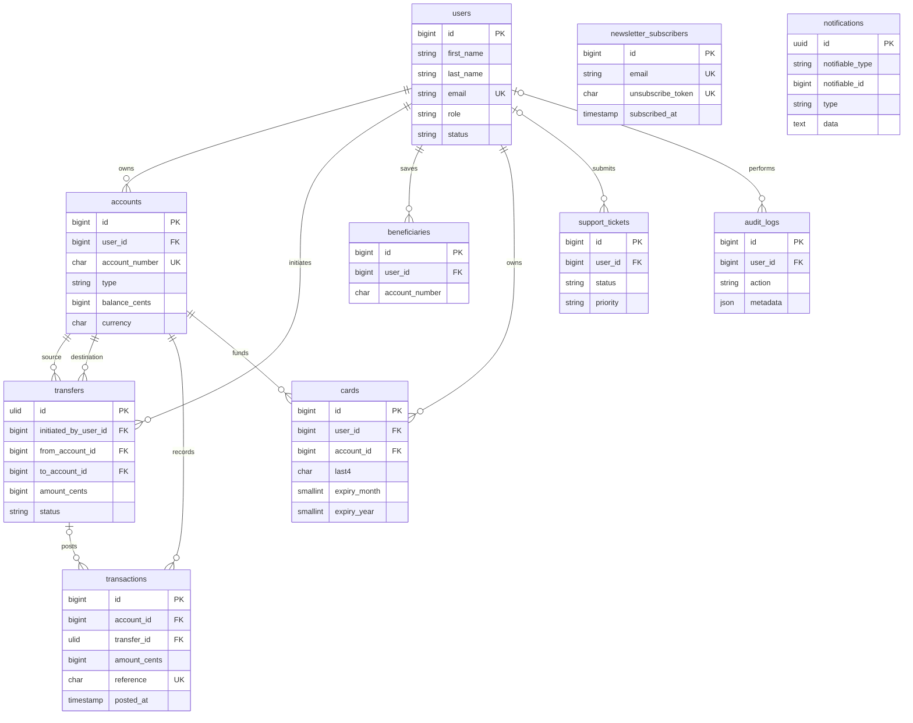

# Database Schema

All tables use InnoDB and utf8mb4. Money values use unsigned integer cents; the MySQL CHECK constraints require MySQL 8.0.16 or later. No full card number or CVV is stored.

- `users`: Customer/admin identity and account status.
- `accounts`: Checking and savings accounts, currency, and current cents balance.
- `transfers`: Transfer intent, participants, idempotency key, and lifecycle state.
- `transactions`: Immutable ledger entries with the resulting account balance.
- `beneficiaries`: User-saved destination account details.
- `cards`: Safe card metadata only: last four digits and expiry.
- `support_tickets`: Contact requests, optionally associated with a user.
- `audit_logs`: User-attributed or anonymous audit events with optional JSON metadata.
- `newsletter_subscribers`: Email consent, confirmation, and unsubscribe token.
- `notifications`: Laravel database notifications; created with `make:notifications-table`.

Laravel cache and queue infrastructure tables are also migrated but are omitted from this domain ER diagram.